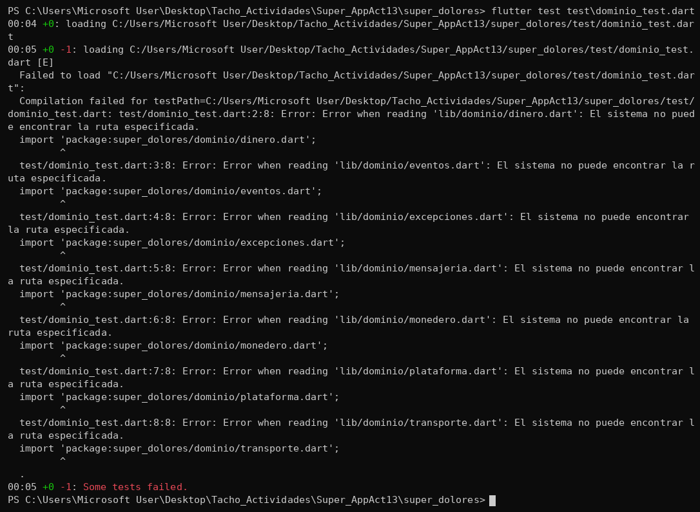
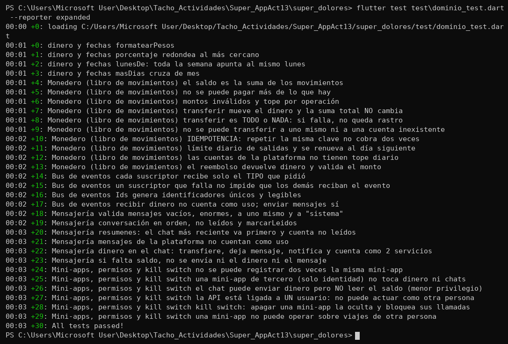
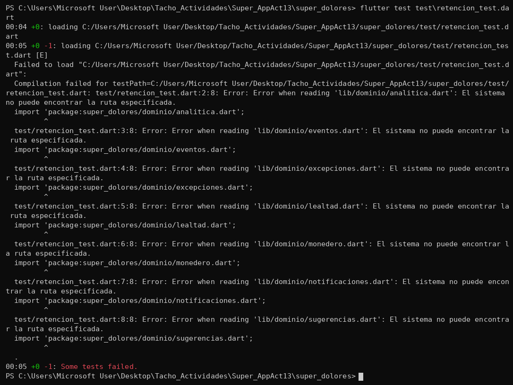
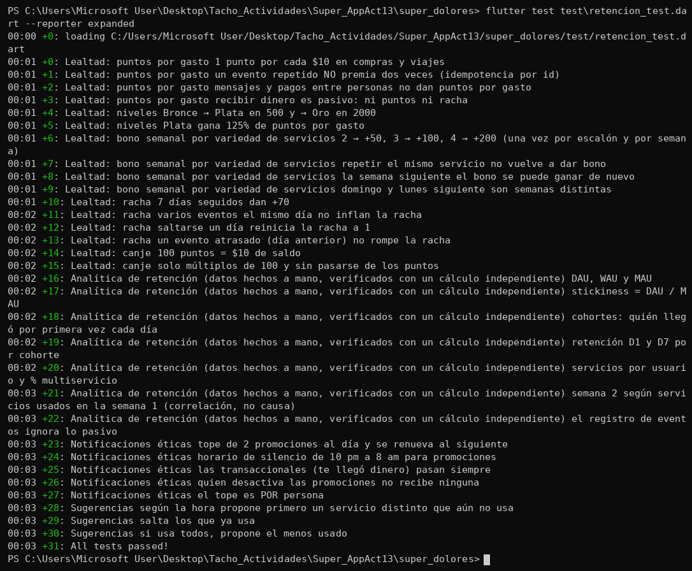
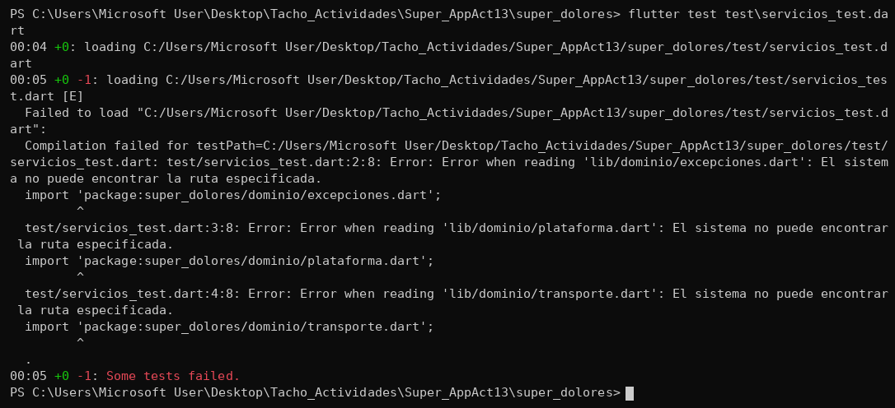
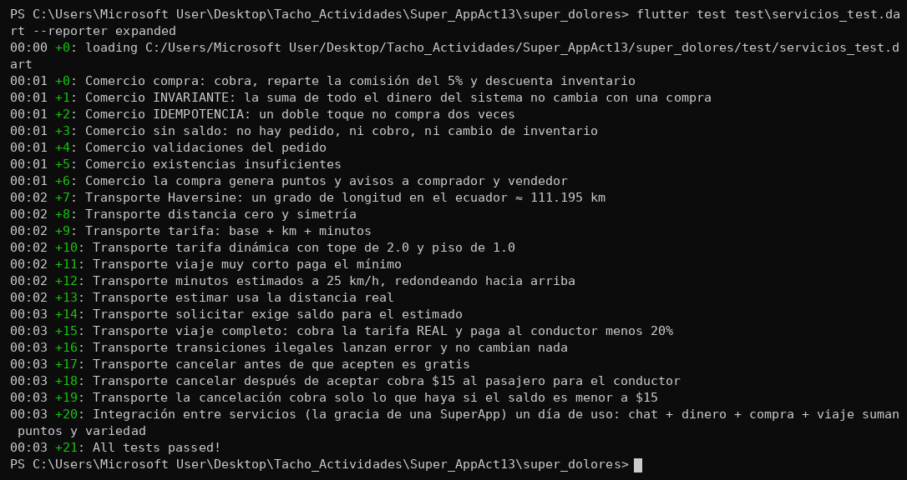
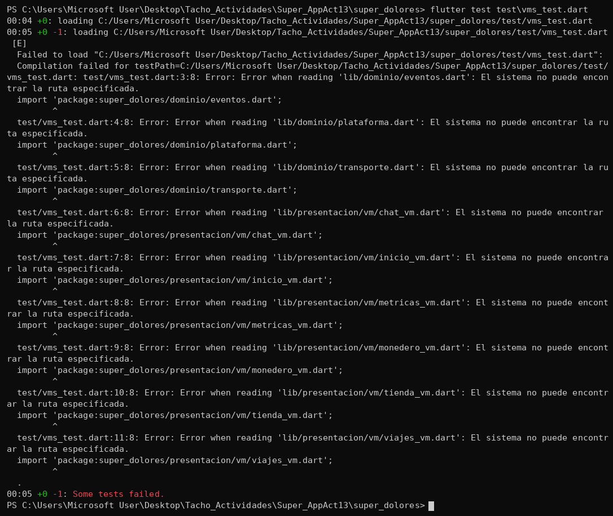
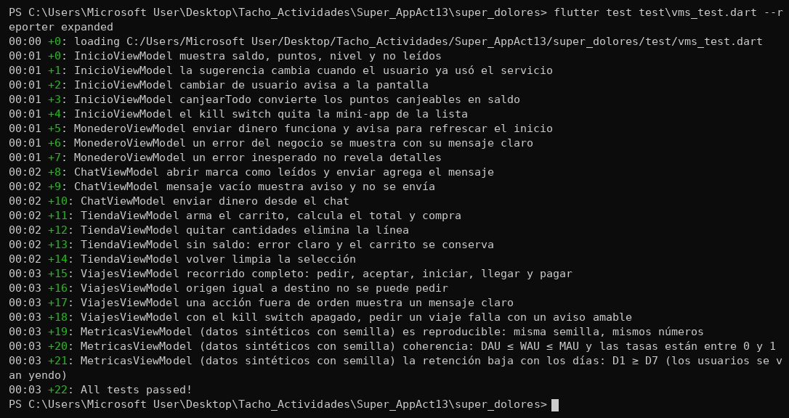
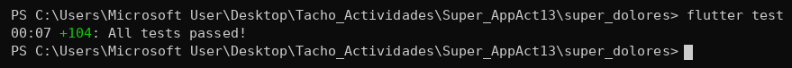

# Super Dolores — SuperApp con TDD

SuperApp didáctica de Dolores Hidalgo hecha en **Flutter** siguiendo el ciclo **TDD (Rojo → Verde → Refactor)**.
En una sola app conviven **mensajería, monedero, comercio local y transporte**, conectados por un bus de eventos,
con mini-apps con permisos, motor de lealtad y tablero de métricas de retención.

- **Materia:** Desarrollo Móvil Integral — UTNG
- **Profesor:** Anastacio Rodríguez García

> ⚠️ Es una simulación educativa: no mueve dinero real ni transporta personas. Todo vive en memoria.

---

## ¿Qué hace la app?

| Módulo | Qué hace |
|---|---|
| 💬 **Mensajes** | Chat entre personas; se puede enviar dinero dentro de la conversación. |
| 👛 **Monedero** | Libro de movimientos: el saldo es la suma de los movimientos. Idempotencia, límites por operación y diarios. |
| 🛍️ **Tienda** | Compras a negocios locales con comisión del 5 % para la plataforma. |
| 🚕 **Viajes** | Solicitar, aceptar, iniciar y terminar viajes (máquina de estados) con tarifa y comisión del 20 %. |
| ⭐ **Lealtad** | Puntos por gasto, bono semanal por usar varios servicios, racha y canje por saldo. |
| 📊 **Métricas** | DAU, WAU, MAU, stickiness y retención por cohortes (datos sintéticos). |
| 🔮 **Horóscopo** | Mini-app de un "tercero" que solo tiene permiso de identidad (no puede ver saldo ni chats). |

Ideas de diseño principales:
1. **Una identidad, un monedero, muchos servicios.**
2. **Los servicios no se llaman entre sí:** publican eventos en un bus.
3. **Mini-apps con permisos mínimos** (principio del menor privilegio).
4. **Kill switch:** se puede apagar un servicio sin publicar otra versión.

---

## Estructura del proyecto

```
super_dolores/
├─ lib/
│  ├─ dominio/          reglas del negocio (Dart puro)
│  │   dinero, excepciones, eventos, monedero, mensajeria, comercio,
│  │   transporte, mini_app, contexto, plataforma, lealtad,
│  │   analitica, notificaciones, sugerencias
│  ├─ presentacion/
│  │   ├─ vm/           ViewModels (inicio, monedero, chat, tienda, viajes, metricas)
│  │   └─ pantallas/    pantallas de cada módulo + horóscopo
│  └─ main.dart         la "concha" (shell) de la SuperApp
├─ test/
│  ├─ dominio_test.dart     (30 pruebas)
│  ├─ retencion_test.dart   (31 pruebas)
│  ├─ servicios_test.dart   (21 pruebas)
│  └─ vms_test.dart         (22 pruebas)
├─ capturas/            evidencias del ciclo rojo / verde
├─ paso1_ROJO.ps1       script: crea el proyecto y corre las pruebas sin código (ROJO)
├─ paso2_VERDE.ps1      script: copia el código y corre las pruebas (VERDE)
└─ pubspec.yaml
```

Total: **104 pruebas**. La app no usa paquetes externos.

---

## Cómo ejecutarlo

### Opción 1: el proyecto ya creado con `flutter create`
1. Copia `pubspec.yaml`, `lib/` y `test/` encima de tu proyecto (reemplazando).
2. Borra `test/widget_test.dart` (el que crea Flutter; usa `MyApp`, que aquí no existe).
3. En PowerShell, dentro de la carpeta `super_dolores`:

```powershell
flutter clean
flutter pub get
flutter test
flutter run
```

### Opción 2: con los scripts (ciclo rojo / verde)
```powershell
Set-ExecutionPolicy -Scope Process Bypass
.\paso1_ROJO.ps1     # crea el proyecto y muestra las pruebas en ROJO
.\paso2_VERDE.ps1    # copia el código y muestra las pruebas en VERDE
```

En la pantalla de inicio puedes cambiar de persona (Ana, Luis, Marta), probar el kill switch,
ver el tablero de retención y abrir la mini-app de horóscopo.

---

## Ciclo TDD — Evidencias

🔴 **ROJO:** se escribe la prueba primero; falla porque el código todavía no existe.
🟢 **VERDE:** se escribe el código mínimo para que la prueba pase.
🔵 **REFACTOR:** se ordena el código sin romper las pruebas.

### 1. Dominio (dinero, monedero, eventos, mensajería, mini-apps)
**🔴 Rojo**



**🟢 Verde**



### 2. Retención (lealtad, analítica, notificaciones, sugerencias)
**🔴 Rojo**



**🟢 Verde**



### 3. Servicios (comercio, transporte, integración)
**🔴 Rojo**



**🟢 Verde**



### 4. ViewModels
**🔴 Rojo**



**🟢 Verde**



### 5. Todas las pruebas


---

## Lista de verificación

- [x] `flutter test` pasa en verde (cuatro archivos de pruebas).
- [x] Mandar dinero en el chat cambia ambos saldos, deja un mensaje y avisa al destinatario.
- [x] Una compra reparte comisión y la suma total del dinero no cambia.
- [x] Un viaje recorre sus estados y los saltos ilegales fallan sin tocar dinero.
- [x] El horóscopo (tercero) no puede leer el saldo ni los chats.
- [x] Apagar Viajes lo quita de la barra y bloquea sus llamadas.
- [x] El tablero muestra DAU, WAU, MAU, stickiness y retención con la advertencia de datos sintéticos.
